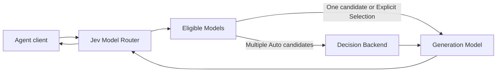

# Agent Model Routing: Choose a Model for Each Agent Request

Agent model routing selects a generation model for each request instead of assigning one model to an entire Agent application. Jev Model Router gives OpenAI Chat Completions and Anthropic Messages clients a stable endpoint, filters models by hard constraints, and uses a Decision Backend only when an `auto` request has multiple eligible choices.

## What is Agent model routing?

An Agent rarely sends one kind of request. The same workflow may summarize a file, reason through a difficult change, call tools, inspect an image, and produce a final report. A fixed model keeps integration simple, but it also applies the same capability, latency, and price profile to every turn.

Agent model routing moves that choice behind one client endpoint. The caller can still use **Explicit Selection** when it needs a known model. With **Auto Selection**, the router first enforces deployment and capability boundaries, then chooses among the remaining **Eligible Models** for that request.

This is request-level selection, not a promise that a router can infer every task perfectly. The routing policy, model descriptions, candidate pool, and evaluation method all affect the result.

## How Jev routes an Agent request



Jev separates hard execution boundaries from editable routing preferences:

1. The router authenticates the request and checks protocol, capability, deployment, capacity, and configured model availability.
2. Zero eligible candidates fail explicitly. One eligible candidate is selected directly.
3. **Explicit Selection** names a configured model and skips the Decision Backend, while still respecting deployment and capability constraints.
4. Multiple candidates in **Auto Selection** invoke the configured Decision Backend. It compares the request with the natural-language **Model Descriptions** and the editable **Routing Prompt**.
5. The selected **Generation Model** produces the actual response or tool call.

Jev does not silently truncate generation requests, drop parameters, or switch models after semantic output begins. See the [compatibility matrix](compatibility.md) for the supported request fields, protocol conversions, and estimation limits.

## Model router, API gateway, or client-side switch?

| Approach | Who chooses the model? | What it centralizes | Good fit |
| --- | --- | --- | --- |
| Fixed model | Application configuration | One model endpoint | Uniform workloads where predictability matters more than per-request tradeoffs |
| Client-side switching | Agent application code | Nothing beyond the application | Small applications with a few explicit, stable routing rules |
| Generic API gateway | Gateway policy or caller | Provider access, credentials, observability, and operational controls | Teams that primarily need a common provider boundary |
| Jev per-request routing | Caller for explicit requests; Jev for multi-candidate `auto` requests | Client compatibility, eligibility constraints, editable routing preferences, execution, and records | Agents whose turns vary enough to justify model selection without embedding routing logic in every client |

These categories overlap. Jev is also an inference gateway, but its distinguishing responsibility is selecting a model for each request from an explicitly configured candidate pool. It does not replace workload-specific evaluation or guarantee that automatic selection will outperform a fixed model.

## Minimal Agent integration

Deploy Jev and configure at least one provider and model before calling the inference API. Multiple-candidate `auto` routing also requires a configured Decision Backend. The [Docker Compose Quick Start](../quickstart/README.md) covers deployment, credential handling, model configuration, and readiness checks.

An OpenAI-compatible client only needs the router base URL, its inference credential, and either `auto` or an enabled public model ID:

```js
import OpenAI from "openai";

const client = new OpenAI({
  baseURL: "http://127.0.0.1:8080/v1",
  apiKey: process.env.JEV_ROUTER_INFERENCE_TOKEN,
});

const response = await client.chat.completions.create({
  model: "auto",
  messages: [{ role: "user", content: "Review this change and identify the highest-risk issue." }],
});

console.log(response.choices[0]?.message);
```

OpenAI Chat Completions and Anthropic Messages both support the documented OpenAI-compatible and native Anthropic generation upstream paths. Native Messages requests preserve their native JSON and stream event structure within the documented field, signature, and model-profile boundaries. Unsupported candidates or conversions fail explicitly rather than silently changing request semantics.

Agents can also install the repository's [companion `jev-router` Skill](../skills/jev-router/SKILL.md) to deploy the service, discover management schemas, configure models, inspect routes, and verify connectivity through the Agent-facing CLI workflow.

## When Jev fits

Jev is a practical fit when:

- an Agent already speaks OpenAI Chat Completions or Anthropic Messages;
- requests vary in difficulty, capability requirements, cost sensitivity, or latency preference;
- model eligibility must respect explicit provider, protocol, capability, or deployment constraints;
- routing preferences should be editable as natural-language model descriptions and a Routing Prompt instead of hard-coded in every client;
- developers want to compare `auto` with fixed-model baselines using their own workload.

## When Jev does not fit

Jev may be unnecessary or unsuitable when:

- every request should use one fixed model;
- deterministic application rules can choose a model more reliably than a Decision Backend;
- the workload requires request fields or protocol combinations outside the current [compatibility matrix](compatibility.md);
- the application requires a guarantee that sensitive conversation text never reaches an external decision service.

Current Jev mode provides no sensitive-data routing guarantee. Conversation text may be sent to the Decision Backend. Image data, tool definitions, tool arguments, and tool outputs are excluded from that decision request, while paired tool IDs and names remain. **Route Inspection** can also call the Decision Backend, incur cost, and transfer data; it is not a purely local dry run.

## Evidence and evaluation boundaries

Jev publishes frozen benchmark snapshots so developers can inspect the tradeoffs instead of relying on a routing claim alone. In the selected [128-task LiveCodeBench replay](benchmarks/livecodebench-128.md), Jev passed 91 tasks versus 88 for fixed Max while using 13.05% less selected-response generation cost. In the independent [96-task non-code snapshot](benchmarks/noncode-96.md), Jev passed 86 tasks versus 88 for fixed Max while using 43.71% less successful-response generation cost. These limited snapshots use different execution protocols, exclude some routing or failed-attempt costs, and do not establish a stable ranking or general production savings.

Use the [evaluation guide](evaluation.md) to define acceptable models and compare automatic routing with fixed baselines on a representative workload. The tracked reproduction guides explain how to recalculate the published snapshots without making paid model calls:

- [Reproduce the LiveCodeBench 128-task snapshot](../scripts/benchmarks/livecodebench-128/README.md)
- [Reproduce the 96-task non-code snapshot](../scripts/benchmarks/noncode-96/README.md)

The right router is workload-dependent. Treat the published results as inspectable evidence for these frozen configurations, then validate Jev against the tasks, models, prices, and constraints your Agent actually uses.
