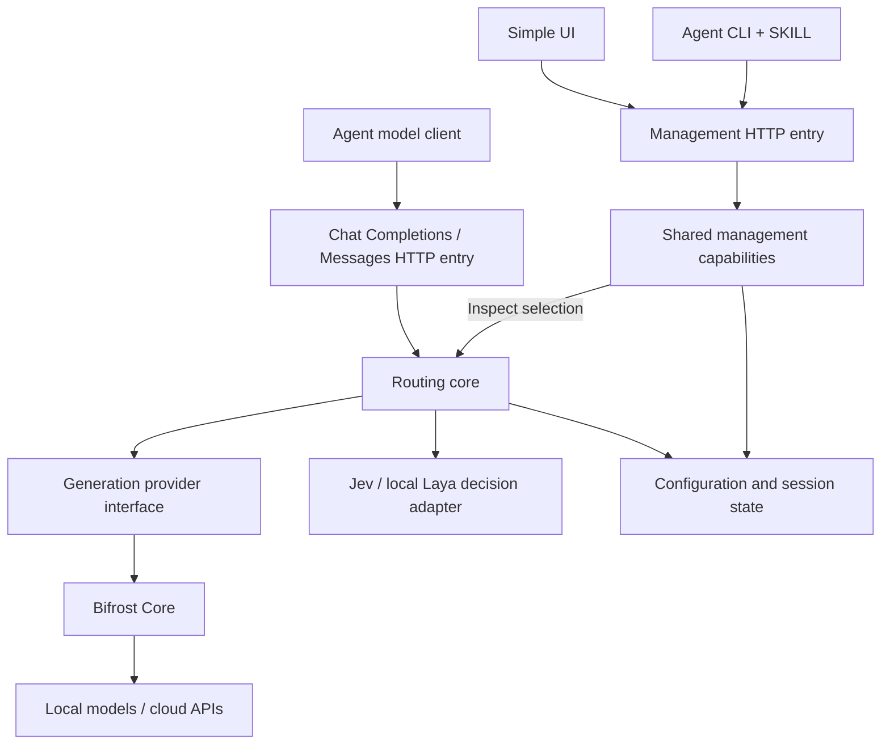

# Architecture

This document records product decisions and implementation boundaries. The phase-one Go/SQLite/CLI/Jev path is implemented; references to phase two remain design goals.

Phase one is tracked in [Issue #1](https://github.com/zerone-agents/jev-model-router/issues/1) and covers single-instance Jev routing, CLI/SKILL and SQLite. Laya, sensitive-session locking and PostgreSQL belong to [phase two #2](https://github.com/zerone-agents/jev-model-router/issues/2). The simple management UI is delivered separately through [Issue #8](https://github.com/zerone-agents/jev-model-router/issues/8), reusing the phase-one management API.

## Entry points and call paths



The CLI and management HTTP handlers use the same management service for authorization, version checks and writes; the HTTP layer authenticates requests. Routing records are best-effort metadata, not an audit log. The running gateway owns mutable state. The CLI accesses that instance through the management API instead of opening a separate SQLite write path. Process operations such as startup and help do not perform model-configuration business operations.

The UI calls only the management API, the shared transport boundary for CLI and UI. An MCP server is not required in the first release. Management and inference APIs can run in one Go process with separate paths and permission scopes.

The initial roles are `inference` and `settings`. Inference credentials can use every enabled model in the instance. Settings credentials identify trusted administrators who can change provider addresses, model mappings and prompts, affecting where subsequent data is sent. These roles separate operations; they do not isolate mutually untrusted tenants.

## Directory layout

```text
cmd/jev-router/           Executable entry point and command assembly
internal/
  app/                   Dependency assembly and service lifecycle
  routing/               Candidate filtering, auto/explicit selection, execution
  management/            Shared model/provider/prompt management and inspection
  decision/              Typed Jev/Laya decisions and protocol adapters
  provider/              Generation provider interface and Bifrost adapter
  state/                 Configuration versions, sessions and storage
  transport/
    cli/                 Command mapping, schema discovery, machine output
    http/                Inference/management handlers and JSON/SSE encoding
contracts/               Management contracts and validation conventions
templates/               The single default balanced prompt
skills/jev-router/       Usage skill distributed with the product
services/laya/           Local Python budget validation and inference adapter
web/                     Simple management UI
docs/adr/                Local architecture decisions (Git-ignored)
```

The initial implementation uses one Go module. It does not pre-create empty packages, generic interfaces or multiple modules. SDK and storage dependencies are pinned in go.mod/go.sum; see compatibility.md for the verified compatibility scope.

## Core boundaries

### Routing and decisions

`routing` determines eligible models and executes one selection. `decision` converts state, prompts and candidate descriptions into Jev/Laya requests. The core does not depend on HTTP handlers, Bifrost schemas or UI data structures. Callers define interfaces for actual use cases instead of introducing a general plugin framework in advance.

`auto` is a reserved public model ID. Neither enabled nor disabled generation models may use it. Creation and ID changes are rejected before saving, keeping lists and request entry points unambiguous. Upstream model names are not subject to this restriction.

`auto` sends eligible candidates and the editable prompt to the decision backend. Explicit model requests skip task-based selection while retaining the same constraints, and failures never switch models automatically. Jev mode does not enable sensitive-data routing. Local Laya may enable it; configuration changes and ordinary follow-up messages do not release a local lock.

Each initial `auto` request selects independently, without caching or model stickiness. No candidates produces an error; one candidate skips model selection but may still need an automatic effort decision; multiple candidates use native Jev `choice`, strictly validated and mapped to model IDs by the adapter. The implementation neither requires nor generates natural-language reasons. It distinguishes explicit selection, a sole candidate, Jev selection and an estimated-capacity fallback. Probabilities are not converted into explanations. Editable prompts govern preferences; the adapter owns native protocol construction and candidate boundaries.

Decision input retains all eligible candidates. Model descriptions have explicit save-time length limits. Fixed instructions, editable preferences and candidates are budgeted first, followed by recent complete conversation groups, with tool calls and results paired and omissions marked. Jev receives no tool definitions. Tool history retains only call IDs, tool names and result associations; arguments, outputs and incidental execution-message text are removed. Generation requests retain the complete original content. Budgets follow the decision backend's native protocol rather than chat-generation output assumptions. Oversized system/developer and latest-query text segments retain their own beginning and end, truncate the middle with [...truncated...], and set content_truncated. A shared text limit is allocated by serialized byte size; short segments remain intact. Multi-candidate `auto` fails only when candidates, requirements and minimum beginning/end structure still exceed the decision budget. Explicit and sole-candidate paths bypass Jev input budgeting but still apply generation capacity rules.

Capacity checks use reliable exact counts when available; otherwise they estimate semantic text, structured content, images and framing separately, add the output reserve once, and disclose the limitations. Preflight checks do not guarantee upstream acceptance. If every eligible auto candidate exceeds capacity only under an inexact estimate, the largest-context model is retained as a fallback. A sole largest model skips model selection but may still need an automatic effort decision; ties go to Jev once. The path is marked context_estimate_fallback. Other capability constraints remain enforced. Explicit models skip local capacity estimates, delegate capacity to the upstream and never switch. An upstream context-limit error fails explicitly without truncating generation input or changing models. This initial estimation policy does not replace future Laya validation of sensitive-input completeness.

Only one balanced prompt template is provided. Descriptions express task specialties and preferences; structured capabilities express context, tool and format constraints. Preferences belong in prompts, protocol constraints in capability configuration; neither substitutes for the other.

### Providers and streaming protocols

`provider` encapsulates Bifrost and accepts an already-selected target. SDK retries and SDK fallback remain disabled; bounded Auto reselection is owned by inference. Client-native encrypted/signed reasoning history is not accepted on the Chat conversion path. Chat-to-native-Anthropic uses validated bodies through Bifrost passthrough. Plain-text thinking can continue; signature omission for signed tool responses is allowed only for the BigModel targets listed in the compatibility documentation, without fabricating signatures. The server explicitly controls model mappings, plugins and extra control fields.

`transport/http` preserves compatible `/v1/chat/completions` and `/v1/models` formats. SSE retains tool-call deltas, usage and errors without exposing internal SDK metadata as protocol fields. Cancellation propagates to decision and generation services. A started stream never appends output from another model.

`/v1/messages` shares the `inference` configuration snapshot, planning timing and record lifecycle. PreparedMessages stores immutable native JSON and selects Bifrost Chat conversion or native passthrough per target. The native path changes only model and bypasses Chat/Responses conversion. A separate decision projection excludes thinking, signatures, redacted content, tool arguments/results and image content/addresses; full request capacity estimates still count them. `PlanPreparedWithEstimate` performs target checks before capacity filtering and Jev without modifying the shared Planner.

Messages accepts inference `x-api-key` or Bearer credentials; when both are supplied they must identify the same principal and role. Error encoding covers authentication, pre-stream JSON and in-stream errors. request-id and X-Request-ID contain the same Router ID. Native targets retain thinking budgets, signatures/redacted blocks, cache, usage and stop semantics; OpenAI-converted targets retain their existing restrictions. Native SSE reads are bounded before parsing, and message_stop waits for clean EOF. max_tokens allows only a valid unfinished object prefix in the final tool block; the router does not complete, execute or retry it. See the [compatibility matrix](compatibility.md#native-messages-clients-with-native-anthropic-upstream-51).

Compatibility promises cover only documented fields and supported provider combinations. Generation input is not truncated and behavior-changing parameters are not silently discarded. Unsupported combinations fail explicitly. Protocol conversion and upstream model-name substitution must preserve supported input semantics.

Multiple OpenAI-compatible and native Anthropic providers/models can be configured. Conversion checks depend on both entry and upstream protocols. Other native protocols such as Gemini are not integrated merely because Bifrost offers an adapter. A provider's compatibility claim does not replace field-combination verification. Response `model` uses the selected public ID consistently in streams. Request IDs appear in headers, and management APIs expose routing metadata; compatible response bodies receive no custom routing fields.

Verified endpoint combinations forward HTTPS image URLs or inline content. The gateway does not fetch remote images, download on behalf of endpoints or re-encode content. Unsupported combinations fail explicitly. Image URLs and inline content enter neither Jev nor routing records; decisions receive only text and image-capability requirements.

Decision, first-generation-event and stream-idle timeouts are configured separately. Ongoing valid output does not trigger the idle timeout; client cancellation propagates immediately. Eligible generation-stage timeouts before semantic output may trigger one Auto reselection. Shared request-budget exhaustion never triggers reselection or changes target health. Started streams end with an error rather than pretending success. Thresholds are established through implementation and validation, not unmeasured service promises.

### Management and state

`contracts/` is the single source of management capability schemas: inputs, outputs, effects, permissions, errors and examples. CLI discovery, management HTTP descriptions and UI forms share these contracts.

Runtime writes validate the complete proposed configuration, then atomically save and publish a new version. Each inference captures an immutable version. New requests use new versions; in-flight requests retain their originals. CLI/UI writes include an expected version; stale writes conflict. Idempotency keys bind to the authenticated identity, operation and input digest.

Disabling affects new requests only. It neither interrupts requests holding old snapshots nor guarantees they cannot subsequently reach the disabled target. Disabling is not emergency revocation: stop the instance or revoke the upstream key. The initial implementation has no in-flight request management system.

Writes use global `expected_version`. The mutation, version increment and idempotent result commit in one transaction. Successful receipts persist for 24 hours and survive restart. Replay lookup precedes version checks; the same key with different input conflicts. Validation failures do not consume keys, and corrected retries still require a valid version. Expired receipts do not guarantee replay; the CLI does not hide retries.

SQLite stores configuration metadata and limited user-text summaries, not full conversations. Credentials support external env:/file: references or managed writes through the API. A separately deployed master key encrypts managed credentials with AES-256-GCM. Immutable revisions bind to a provider or independent decision-backend identity; reads return references and masked status. Ciphertext, configuration and idempotent receipts commit together. Rotation preserves old references for in-flight requests. Historical ciphertext is not yet collected; master-key rotation needs separate implementation. Phase two adds session state, per-session serialization within one instance and persistent local locks. Initial independent auto requests have no session locks. Transactions remain short and never span model network calls; cross-replica locks and storage scaling require separate design.

Routing records default to seven days and at most 100,000 entries, both configurable, evicting oldest entries when exceeded. They contain model ID, configuration version, selection path, selection latency and outcome, plus at most 120 characters from the final user message. They exclude generation latency, full conversations, tool arguments/outputs, image addresses and free-form decision reasons. Initial Jev provides no natural-language reason, and inspection fabricates none. Recording is best effort: failures do not block inference but must surface warnings and degraded status. Configuration-write failures still fail explicitly. Records are not a mandatory audit mechanism.

Route inspection reuses planning without generation or changes to configuration/session locks. Results include configuration version, candidates, decision metadata and state changes execution would cause. Actual execution validates again; inspection is not an authorization token. Capability descriptions disclose possible decision cost and external transmission.

## CLI, SKILL and UI

The executable is `jev-router`. `serve` provides APIs and embedded `/dashboard/`; `schema`/`call` provide machine management; `dashboard` opens an existing instance or prints its URL. Offline help and runtime contracts define arguments.

CLI management and dashboard commands emit structured JSON, with logs on stderr and no banners or animations on stdout. Management responses are separate from Chat Completions responses; model APIs do not use the AgentUse envelope.

The SKILL explains when to discover capabilities, choose operations, interpret failures and verify results. Runtime schemas define fields and commands. The skill ships as a product asset in the repository/release package and is not automatically installed into developers' personal skill directories.

The management UI supports inspection and adjustment of status, model descriptions, prompts and records, plus limited text generation through the dedicated Playground capability below. Shared services retain core routing logic. Ordinary management permissions do not expand because of the UI; the Settings-session generation exception is explicit. Go embeds React assets, and business calls use same-origin management APIs. The browser exchanges Settings credentials for fixed seven-day HttpOnly sessions. SQLite stores only session hashes; sessions survive restart and logout revokes the current request's session. CLI authentication remains Bearer. Initial editing is limited to descriptions and prompts; other configuration uses the CLI.

## Implementation order and validation boundaries

1. Define and implement minimum management contracts, CLI schema and structured errors; update the SKILL.
2. Implement model configuration, the single balanced template, versions and persistence.
3. Implement Jev selection, explicit models, Bifrost calls and Chat JSON/SSE.
4. Implement Laya complete-input validation, sensitive routing and session locking.
5. Integrate the simple UI using shared management capabilities.

Tests live beside modules. Cross-boundary tests cover CLI/HTTP consistency, conflicts, idempotency, cancellation, SSE, explicit selection without implicit fallback and sensitive data staying off cloud services. Real selection quality and program constraints are evaluated separately.

Initial evaluations use representative tasks and acceptable model sets to compare `auto` and fixed-model generation quality and selection preferences. See [validation and evaluation](evaluation.md). Total cost and comparable latency need separate study. Establish measured baselines before quality thresholds. Program constraints must pass independently; selection quality cannot offset protocol errors.

ArbiterOS tool-execution governance remains future work. The current architecture creates no empty governance interfaces and claims neither an execution sandbox nor AgentUse certification. Capability contracts and risk grading follow the [AgentUse protocol](https://www.zerone.run/zh/protocol), verified through repeatable checks after implementation.

## Generation upstream protocols

Provider.protocol distinguishes openai and anthropic; old configurations default to openai. Both OpenAI Chat and Messages entries select across these protocols, checking native fields per candidate. Bifrost types and conversion guards remain in provider. Request checks precede capacity filtering and Jev; only unsupported_request excludes a candidate, while internal failures return directly. OpenAI Chat clients selecting Anthropic receive a default output limit and target reserve of 65536. Messages still requires max_tokens. OpenAI retains a 4096 estimate without injecting a limit. SDK caches isolate protocol, URL, credentials and configuration without mutating in-flight snapshots.

## Playground

Dashboard text generation uses a dedicated Cookie-only endpoint, sharing request decoding, planning, upstream calls and first-event checks with public `/v1/chat/completions`. Playground emits route immediately after planning; public Chat waits for its first valid event before committing a streaming response. Entry points retain separate authentication, limits and encoding. They do not call themselves over loopback HTTP or expose inference credentials to browsers. Playground remains limited to streaming text input; new capabilities require explicit enablement. Both paths share `internal/inference` snapshots, planning and records plus the existing Executor. `internal/playground` handles short atomic admission and single-process concurrency; `internal/state` stores session/instance rolling windows and UTC daily quotas. Admission precedes model calls. Database failures cannot bypass quotas; cancellations/failures are not refunded, and execution exit releases concurrency.

This explicitly extends Settings-session permissions: administrators can generate in Playground without inference credentials. Ordinary Settings Bearer, management call and /v1 authentication remain unchanged. Machine contracts publish the browser-specific request/stream protocol; the UI has no hidden selection implementation. Initial input is text-only and executes no tools. Streamdown renders generated text. Reasoning drives only the thinking indicator and protocol-required in-memory history; CSP is unchanged.

## Upstream error diagnostics

Decision and generation adapters sanitize upstream error bodies at response boundaries. routing.Diagnostic carries optional upstream_error details shared by public Chat/Messages and Playground JSON/SSE. Details retain structured JSON or plain text with bounded size and explicit truncation; the UI renders escaped text only. Internal SDK diagnostics, raw requests and unsanitized credentials never enter public responses. Details are not saved in routing records or browser persistent storage. contracts/README.md defines fields and limits.

## Generation upstream health

`internal/health` maintains unknown/healthy/isolated states independently of configuration enabled. Auto excludes isolated targets before Jev, including capacity fallback paths; explicit requests still reach the upstream. Identity is isolated by model-resource revision, provider, protocol, address, upstream model and actual credential revision. Provider resolves credentials once; planning carries an opaque snapshot through execution, authentication, client caching and redaction. Late results cannot overwrite newer observations.

SQLite stores health and an independent fingerprint key. Health updates do not consume configuration versions, and isolation survives restart without a managed master key. Normal traffic supplies passive observations. Background recovery probes are bounded and target only enabled isolated models; manual models.test shares probe concurrency limits. Health measures availability rather than answer quality. Jev decisions are not isolated, and health introduces neither automatic model switching nor retries.

### Automatic effort selection

Optional model auto_effort configuration is managed through the shared CLI/API
contract and persisted in existing configuration snapshots. The UI displays effort read-only and has no effort
configuration controls. Jev independently chooses model and task effort
in one call; the planner adapts the effort to the selected model's allowed levels,
falling down or to the lowest configured level. This is not pairwise optimization.
Caller effort, disabled thinking and fixed budgets take precedence. Explicit
models retain their existing behavior. Generation applies the final parameter to
an attempt-local full request copy, including native Messages bodies; fallback
never reuses injected parameters as caller constraints. Chat-only inspection
reports the effective parameter; native Messages is validated by execution.

Playground route events expose optional `effective_effort` for the current attempt. The dashboard shows configured automatic effort levels and the actual outgoing effort read-only. Missing effort is shown as not set, without inferring provider defaults. Configuration remains CLI/Agent-managed; successful public inference response metadata is unchanged.

Routing records expose optional `effective_effort` on the record and each generation attempt. The record retains the latest generation attempt value, including when a subsequent routing attempt fails. A later generation with no effort clears the previous value. Historical and unset values display as an em dash; no provider default is inferred. Attempt diagnostics carry the same optional field. Existing JSON record storage requires no table migration.
